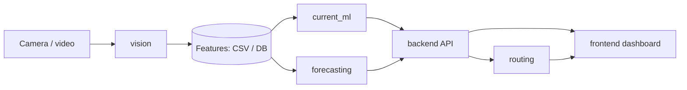

# Architecture

| Stage | Input | Output |
|---|---|---|
| vision | video frames | per-window traffic features |
| data_pipeline | features | database tables, labelled datasets |
| current_ml | features | Low / Moderate / Heavy / Severe |
| forecasting | recent feature windows | class probabilities for the next 15 min |
| backend | model outputs | JSON API |
| frontend | API | live status, cards, alerts, charts |
| routing | predicted congestion + map API | alternative route |

Principle: modules talk only through the contracts in `data_contract.md`, so each can be built and tested on its own.
